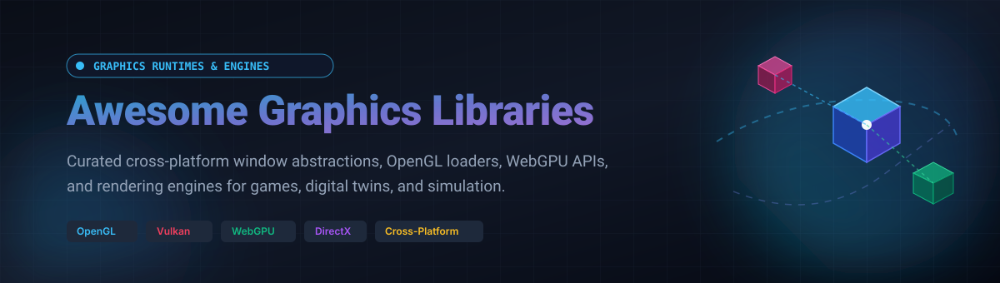

# 🎨 Awesome Graphics Libraries      

  

## 🚀 Top Graphics Libraries Ecosystem

> **A curated showcase of high-performance graphics engines, cross-platform window abstractions, OpenGL loaders, WebGPU APIs, and cloud-hosted 3D rendering platforms.**

*Last updated: October 2026*

This repository tracks top-tier **cloud SaaS platforms** and **open-source frameworks** across the modern graphics ecosystem. These tools provide the foundational plumbing for graphics programming—creating windows, configuring Vulkan/Metal/DirectX/OpenGL contexts, loading runtime function pointers, handling real-time input, and streaming complex 3D meshes—empowering engineers to focus on rendering innovations rather than platform-specific boilerplate.

---

## 📑 Table of Contents

- [📊 Sector Overview & Market Dynamics](#-sector-overview--market-dynamics)
- [☁️ SaaS & Hosted 3D Platforms](#️-saas--hosted-3d-platforms)
- [⚡ Open-Source GitHub Projects](#-open-source-github-projects)
- [🛠️ Architectural Guidance & Framework Selection](#️-architectural-guidance--framework-selection)
- [🤝 How to Contribute](#-how-to-contribute)
- [💖 Support](#-support)
- [📈 Star History](#-star-history)
- [⚖️ Disclaimer](#️-disclaimer)

---

## 📊 Sector Overview & Market Dynamics

The computer graphics software and cloud rendering market represents an estimated **$10.1 billion to $11.1 billion** market size globally in 2026 (part of the broader $190+ billion computer graphics hardware, services, and software ecosystem), expanding at a compound annual growth rate (CAGR) of 8.9% to 9.8%.

The sector is **moderately concentrated at the high-end cloud infrastructure and commercial engine tiers** (where major ecosystems like Epic Games, Unity, Autodesk, and Bentley Systems maintain strong network moats and platform lock-in), yet **remains highly fragmented and decentralized across the open-source library layer**, where minimalist, modular, and specialized runtime projects (such as GLFW, SDL, Three.js, and wgpu) thrive independently across desktop, mobile, and web runtimes.

---

## ☁️ SaaS & Hosted 3D Platforms

| Platform | Description | Pricing (Starting Tier) | Free Tier Limits | Valuation / Market Cap / Revenue |
| :--- | :--- | :--- | :--- | :--- |
| **[Sketchfab](https://sketchfab.com)** | 3D asset hosting, WebGL/WebXR viewer platform, and 3D model marketplace (Subsidiary of Epic Games). | Pro plan at $15/month ($180 billed annually) | Free Basic plan: 100MB per upload file size cap, public model uploads, unbranded player not included | ~$22.5B Valuation (Parent: Epic Games) |
| **[Unity Cloud](https://unity.com/products/cloud)** | Cloud graphics ecosystem and developer backend offering asset management, remote rendering, diagnostics, and automated build pipelines. | Pro plan at $210/seat/month ($2,310/seat/year) | Free Personal plan: Eligible for users/teams with <$200k/yr revenue or funding; includes 25 GB DevOps storage, 100 Mac build minutes/mo, 100 GB/mo egress | ~$19B Market Cap / ~$2.1B Annual Revenue |
| **[Cesium ion](https://cesium.com/platform/cesium-ion/)** | 3D geospatial data platform for tiling, hosting, and streaming massive 3D terrain, photogrammetry, and CAD/BIM data to browsers via 3D Tiles (Subsidiary of Bentley Systems). | Commercial Individual plan at $149/month | Free Community plan: Personal/non-commercial use only, 10 GB cloud storage, 15 GB/month data streaming quota | ~$11B Market Cap (Parent: Bentley Systems) |
| **[PlayCanvas](https://playcanvas.com)** | Cloud-hosted collaborative WebGL/WebGPU 3D HTML5 game engine and visual editor platform (Subsidiary of Snap Inc.). | Personal plan at $15/month | Free plan: Unlimited public projects, 1 GB asset storage, PlayCanvas-branded loading screen, free PlayCanvas URL hosting | ~$10.6B Market Cap (Parent: Snap Inc.) |
| **[Spline](https://spline.design)** | Web-based collaborative 3D design and real-time graphics authoring tool with interactive WebGL export and React/web embedding. | Hobby plan at $12/month (billed annually) or $15/month (billed monthly) | Free plan: Limited personal files, unlimited viewers, public sharing with Spline watermark/logo, basic AI generation prompts | ~$75M Valuation / ~$5M ARR |
| **[Vectary](https://www.vectary.com)** | Browser-based 3D modeling, Augmented Reality (AR) asset creator, and interactive WebGL scene embed platform. | Pro plan at $15/month (billed annually) or $19/month (billed monthly) | Free Starter plan: Up to 10 active projects, 1 workspace seat, 3,000 monthly AI credits, Vectary-branded embeds | ~$37M Valuation / ~$6M ARR |

---

## ⚡ Open-Source GitHub Projects

The open-source landscape provides developers with total transparency, custom windowing backends, zero-overhead render loops, and hardware-accelerated drivers. Entries below are sorted in descending order by GitHub stargazers count:

- **[Three.js](https://github.com/mrdoob/three.js)**   
  🌐 The de facto JavaScript 3D library for the web. Provides an intuitive scene graph, physically-based materials, WebGL/WebGPU renderers, shadows, post-processing pipelines, and extensive geometry loaders (glTF, OBJ, FBX). Ideal for interactive web experiences, creative agency showcases, and data visualizers.

- **[Dear ImGui](https://github.com/ocornut/imgui)**   
  🖥️ Bloat-free, immediate-mode graphical user interface library for C++. Generates dynamic debugging overlays, level editors, asset inspectors, and toolbars with virtually zero performance overhead. Directly integrates into OpenGL, Vulkan, DirectX, Metal, WebGPU, GLFW, and SDL pipelines.

- **[Raylib](https://github.com/raysan5/raylib)**   
  🎮 A minimalist, zero-dependency C library designed for learning, rapid prototyping, and indie game engineering. Features an uncluttered, immediate-style drawing API, crystal-clear game loops, and native OpenGL abstraction (2.1 to 4.3 and ES). Best for students, game jams, and developers wanting the shortest path from C/C++ code to pixels.

- **[Babylon.js](https://github.com/BabylonJS/Babylon.js)**   
  🪐 Full-featured, batteries-included 3D web rendering engine maintained by Microsoft. Boasts native WebGPU and WebXR backends, integrated Havok physics, advanced particle emitters, PBR workflows, and GUI managers. Built for complex browser games, digital twins, and industrial CAD/BIM visualizers.

- **[Filament](https://github.com/google/filament)**   
  💡 Google's real-time physically based rendering (PBR) engine written in C++ for Android, iOS, Windows, Linux, macOS, and WebAssembly. Engineered to be as compact and efficient as possible on mobile and embedded GPUs while delivering hyper-realistic materials, atmospheric scattering, and customizable render targets.

- **[wgpu](https://github.com/gfx-rs/wgpu)**   
  🦀 Pure-Rust, safe, portable graphics and compute API based on the WebGPU standard. Automatically targets Vulkan, Metal, Direct3D 12, and WebGPU/WebGL2 backends. Core infrastructure for next-generation Rust graphics stacks, GUI engines, and game frameworks like Bevy.

- **[bgfx](https://github.com/bkaradzic/bgfx)**   
  🧱 Cross-platform, graphics API-agnostic rendering library supporting Direct3D 11/12, Vulkan, Metal, OpenGL, and WebGPU. Implements command-buffer rendering to decouple draw submissions from execution, making it favored in production commercial game engines and multi-threaded rendering pipelines.

- **[SDL (Simple DirectMedia Layer)](https://github.com/libsdl-org/SDL)**   
  🕹️ The industry-standard multimedia and windowing workhorse powering thousands of commercial games on Steam, PlayStation, Nintendo Switch, iOS, and Android. Provides window management, OpenGL/Vulkan/Metal context instantiation, multi-channel audio, haptics, threading, and gamepad abstraction.

- **[CesiumJS](https://github.com/CesiumGS/cesium)**   
  🌍 Open-source JavaScript library for world-class 3D globes and geospatial maps. Streamlines real-time rendering of terrain, satellite imagery, photogrammetry, Point Clouds, and 3D Tiles at planetary scale directly in web browsers under Apache 2.0.

- **[GLFW](https://github.com/glfw/glfw)**   
  🪟 The minimalist standard for window creation, OpenGL/Vulkan contexts, and input handling. Written in C99 with a lightweight zlib/libpng license. Free of audio or asset-loading bloat; gives the developer absolute control over the render loop. Ideal for custom rendering engines and academic graphics coursework.

- **[SFML (Simple and Fast Multimedia Library)](https://github.com/SFML/SFML)**   
  🧩 Clean, idiomatic modern C++ multimedia framework with RAII resource management. Encapsulates windowing, hardware-accelerated 2D graphics (sprites, vertices, text, render textures), audio mixing, and networking. Highly recommended for C++ programmers building 2D games and interactive simulations.

- **[Sokol](https://github.com/floooh/sokol)**   
  📦 Minimalist, header-only C99 libraries for cross-platform app wrappers (`sokol_app.h`), modern 3D graphics abstraction (`sokol_gfx.h`), audio, and input. Features ultra-fast compilation, zero external runtime dependencies, and seamless compilation to WebAssembly/WebGL2.

- **[Silk.NET](https://github.com/dotnet/Silk.NET)**   
  🔷 High-speed, advanced .NET Foundation bindings library covering OpenGL, Vulkan, OpenCL, OpenAL, DirectX, and WebGPU. Generates high-performance, strongly-typed C# wrappers with low memory footprint, supporting desktop, mobile (iOS/Android), and WebAssembly.

- **[GLAD](https://github.com/Dav1dde/glad)**   
  🔌 Modern, multi-language Vulkan/GL/GLES/EGL/GLX/WGL loader generator based on official Khronos XML specifications. Allows developers to tailor generated headers specifically to required API extension subsets with zero runtime dependency overhead.

- **[OpenTK](https://github.com/opentk/opentk)**   
  🧱 Time-tested C# wrapper for OpenGL, OpenAL, and OpenCL featuring an integrated linear algebra math library (vectors, matrices, quaternions) and simplified `GameWindow` abstractions for desktop .NET runtime development.

- **[GLEW (Legacy)](https://github.com/nigels-com/glew)**   
  📜 Classic OpenGL Extension Wrangler library. Retained for historical reference and legacy codebase support; developers initiating new projects are encouraged to adopt GLAD for active maintenance and modern core profile compatibility.

---

## 🛠️ Architectural Guidance & Framework Selection

- **Minimalist Render Loops**: Pair **GLFW** with **GLAD** for maximum control over buffer swaps and context state without extra framework weight.
- **Cross-Platform Commercial Games**: Adopt **SDL** to leverage production-grade input controllers, audio engines, and native mobile/console support.
- **Web 3D & Data Visualization**: Choose **Three.js** for modular creative tools and e-commerce, or **Babylon.js** when native WebGPU compute shaders, physics, and scene editors are required.
- **Embedded & Mobile Systems**: Deploy **Filament** for cutting-edge mobile PBR rendering or **Sokol** for compact header-only simplicity.
- **C# / .NET Ecosystem**: Leverage **Silk.NET** for cross-platform desktop and mobile coverage across modern APIs, or **OpenTK** for straightforward LearnOpenGL desktop workflows.

---

## 🤝 How to Contribute

Contributions are warmly welcomed! Help make this ecosystem resource even better:

1. 🍴 **Fork** the repository.
2. 🌿 **Create a branch** for your library addition (`git checkout -b feature/add-graphics-lib`).
3. 📝 **Add or update** entries in `README.md` maintaining factual consistency and format.
4. 🚀 **Submit a Pull Request** with a brief summary of the project's highlights.

---

## 💖 Support

A massive **thank you** to all contributors, maintainers, and graphics developers pushing real-time computing forward! 🌟

If you find this repository valuable:
- ⭐ **Star this repository** to help others discover it.
- 🍴 **Fork and share** it with fellow graphics programmers and engine developers.
- ☕ **Support the creator**: Buy a coffee or become a sponsor via the [GitHub Sponsors Dashboard](https://github.com/sponsors/ishandutta2007).

---

## 📈 Star History

---

## ⚖️ Disclaimer

- This is an independent, community-curated collection intended for educational and architectural reference.
- Trademarks, logos, and brand names are property of their respective owners.
